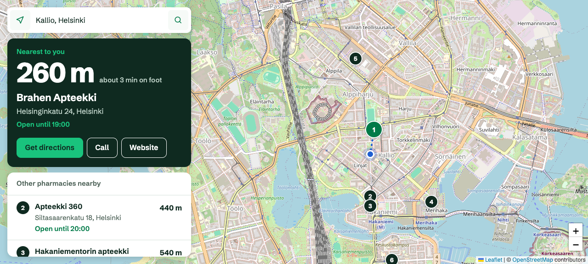

# Nearest pharmacy (web)

A small web app that finds the pharmacy closest to you. Share your location or type
an address, and it shows the nearest pharmacies ranked by distance on a map and in a
list, with opening hours where they are known.

**Live demo:** https://tommipalasvirta.github.io/nearest-pharmacy-web/



The iOS version is in [nearest-pharmacy-ios](https://github.com/tommipalasvirta/nearest-pharmacy-ios).

## Run it

You need Node.js 20.19 or newer (22.12+ if you are on Node 22). No API keys or
accounts are required.

```sh
git clone https://github.com/tommipalasvirta/nearest-pharmacy-web.git
cd nearest-pharmacy-web
npm install
npm run dev
```

Open http://localhost:5173 and either:

- click **Use my location** and allow the browser prompt, or
- type an address or place name, for example `Mannerheimintie 5, Helsinki`.

Browsers only share a location on `localhost` or HTTPS, so use the `localhost` URL
rather than a LAN IP address.

Other commands:

| Command | What it does |
| --- | --- |
| `npm test` | Runs the unit tests (Vitest) |
| `npm run build` | Type-checks and builds to `dist/` |
| `npm run preview` | Serves the production build locally |
| `npm run lint` | Lints with oxlint |

## How it works

1. **Where you are.** The browser Geolocation API, or an address geocoded with
   Nominatim when you would rather not share a location (or have blocked it).
2. **What is nearby.** Every OpenStreetMap object tagged `amenity=pharmacy` within a
   radius. The radius starts at 1.5 km and widens to 5, 15 and 50 km until there are
   at least five results, so a city centre gets one small query and a rural area
   still finds something.
3. **Ranking.** Great-circle (haversine) distance from you, nearest first.
4. **Opening hours.** The OSM `opening_hours` tag is evaluated for the current time,
   including public holidays for the country you are in.

The map fills the screen and the answer floats over it. The nearest pharmacy comes
first, with its distance, an estimated walking time and a directions link, and a
dotted line on the map runs from you to it. The numbered pins match the ranks in the
list, and selecting either one highlights the other. On a phone the results sit in a
sheet under the map: the nearest pharmacy is always visible and the rest of the list
opens on demand.

Every state has its own screen: locating, searching, location blocked, location
unavailable, address not found, no pharmacies in range, and network failure with a
retry.

## Data source and tradeoffs

Pharmacy data comes from **OpenStreetMap**. It is free, needs no key, covers the
whole world and carries opening hours, phone numbers and websites. Google Places has
better coverage in some countries, but it needs a billing account and a key that
would either be committed to the repo or have to be supplied by whoever runs the app.

There are two ways to query OSM, and the app uses both:

- **Overpass API** is the primary source. It is built for "everything with this tag
  within this radius", and it returns pharmacies mapped as points and as building
  outlines alike.
- **Nominatim** is the fallback. While building this, the public Overpass servers
  were taking 30 to 40 seconds to answer, and the mirrors were timing out. An app
  that waits that long looks broken, so the request is hedged: if Overpass has not
  answered within 3 seconds, or fails, the same search also runs against Nominatim
  and the first answer wins. For the test area both sources returned the same 26
  pharmacies.

Nominatim returns at most 40 places per search in no useful order, so a full
response might be missing the nearest pharmacy. When a response is full, the search
area is halved until everything fits; see `searchNominatim` in
[`src/lib/nominatim.ts`](src/lib/nominatim.ts).

Other choices:

- **React, TypeScript and Vite**, with Leaflet for the map. Leaflet is used directly
  through a ref rather than through a wrapper library; the map needs three effects.
- **Layout.** The first version had the list in a side panel next to the map. I put
  that screen on a [Superdesign](https://superdesign.dev) canvas with two alternative
  layouts and went with the map-first one, since the map is what you navigate by.
- **No backend.** Everything runs in the browser. A production version would put a
  small server in front of the data sources to cache results and stop depending on
  volunteer-run public instances.
- **The `opening_hours` parser is about 1 MB**, because the tag's grammar is large
  (holidays, week numbers, sunrise). It is loaded on demand after the first results
  arrive, so it does not slow down the first paint.

## Project structure

```
src/
  lib/                    Framework-free logic, all unit-tested
    geo.ts                Haversine distance, distance formatting
    search.ts             Widening radius and hedging between sources
    overpass.ts           Overpass source
    nominatim.ts          Nominatim source, geocoding, reverse geocoding
    openingHours.ts       Open/closed status from the OSM tag
    geolocation.ts        Promise wrapper for the Geolocation API
  hooks/
    usePharmacySearch.ts  The search flow as one state machine
  components/             Map, search bar, results sheet, status messages
  App.tsx                 Start screen and the map-first results layout
```

## Known limitations

- Distances are straight lines. Walking routes are longer, and the walking time is
  an estimate at 4.8 km/h.
- Results are only as good as OpenStreetMap is locally. A pharmacy missing from OSM
  is missing here, and opening hours are shown only where someone has mapped them.
- Open/closed status is computed when the results load and does not update while
  the page stays open.
- The app relies on free public servers (Overpass, Nominatim, OSM tiles) that have
  usage policies and occasional outages. It is fine for a demo and for light use,
  but not for production traffic.
- Opening hours are evaluated in the browser's time zone, which is wrong if you
  search an address in another time zone.
- Only the data layer has automated tests. The UI was checked by hand in Chrome at
  desktop and phone widths.

## License

MIT. Map data © [OpenStreetMap](https://www.openstreetmap.org/copyright) contributors.
